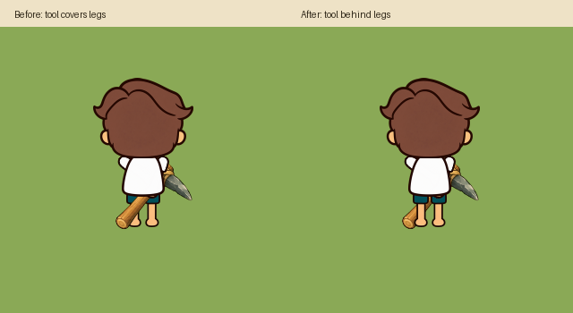
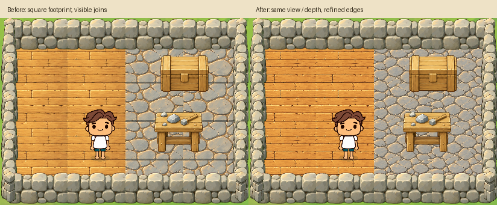
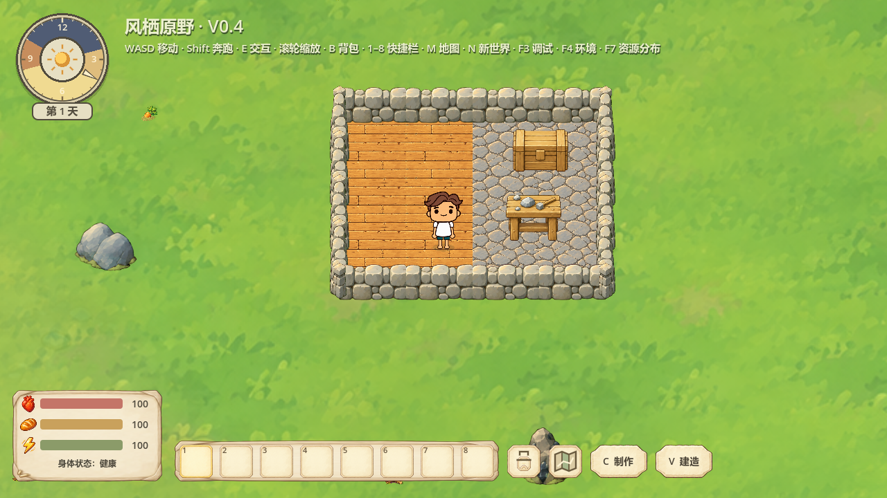

# 背视工具图层与方形地板接缝修订

## 本批已于2026-10-18正式采用
用户之后明确“可以的，可以接入游戏了”。四PNG已按哈希迁入assets/buildings/v3，正式结果见[采用报告](../floor-formal-v3/REPORT.md)。以下原文是确认前的候选阶段记录；本批待确认限制已由具体批准覆盖，不能延伸为未来素材批准。

2026-10-18；Godot4.7.2 Stable / Windows / Compatibility / RTX5060。

## 当前结果与采用边界

背视工具图层修复已用于正式代码scripts/held_tool.gd。地板是独立待验收候选，当前版本prototypes/camp-floor-seams-v2/final；没有覆盖或更改已批准的20张建筑PNG，也没有自动推广至正式建造。用户认可方形轮廓的拼接后，本轮继续按要求修订左右边的纹理和色差，保留视角和厚度。新美术仍按用户“未经确认，不得覆盖已批准美术”的要求等待具体视觉确认。

## 工具图层

右臂本来在躯干后但仍在双腿前。现在原节点照常计算握点/工具变换，仅背视将工具显示拷贝到Visual内双腿后方的局部层（show_behind_parent=true、z_index=0）；隐藏原工具，保持唯一可见实例。转身回正/侧面恢复原显示，拾取/卸下清理显示，无全局负Z，不影响世界景物Y排序。所有工具共用该路径，未改PNG、角色支点、动画时序、耐久或采集收益。

## 方形铺面及纹理

方形世界平面保持原镜头，投影仍为96×64直边矩形。首轮专门生成顶面和薄前沿，内部只拼顶面，厚度仅在向南外露边显示；没有填色底块，也不再整体放大旧地板重叠来封缝。V1候选图样仍出现左右亮度/纹理落差，用户指出后，V2仅重新绘制顶面材质，不改轮廓、顶面比例或薄前沿。

- V2木/石顶面均1536×1024，按相同比例绘制96×64，无旋转/镜像/挤压。
- 木/石前沿仍是V1的636×21原文件，2/2字节相同，世界厚度始终21×96/636=3.1698单位。
- 左右RGB平均差（0..255，实际96×64采样）木20.64→7.46、石35.54→23.00。该数值说明接缝改善，不是精确周期边界，也不能替代实际美术验收。石缝与木板本身的自然拼缝保留。
- 当前预览图及原图/来源均保留，没有将生成器承诺当作像素匹配证明。

## 实测

|项目|结果|证据|
|---|---|---|
|四工具背视、原握点一致、正侧面恢复、拾取/卸下|真实窗口133项0失败|back-layer-window.log / back-layer-tests.json|
|GPU腿部遮挡|自然7阶段及额外受控交叠，2554腿部内部像素修复，残留错误0；抗锯齿轮廓不作实心遮挡判定|back-layer-tests.json，stress-*图|
|原交互、背视劳动命中/时序、快捷栏卸下必要依赖|无头79、窗口79，均0失败|dependencies-headless.log / dependencies-window.log|
|V1方形候选|窗口12项0失败|square-floor-window.log|
|V2纹理修订候选|窗口12项0失败；木/石/混铺在0.75/1/1.25缩放、非整数位置的内部露绿0，960/1280/1600窗口实景留档|seams-v2-window.log / seams-v2/square-floor-tests.json|
|视角比例/厚度|顶面3:2相同比例，前沿2/2字节不变|seams-v2/texture-seam-metrics.json|
|原批准美术|20/20 SHA256一致|approved-art-audit.json|

窗口均由自动控制器驱动，不等于长期人工试玩。样例入口Start-Floor-Square-Preview.cmd使用独立同Seed临时世界，只供观察已布置的样例地板，不写正式存档；新增建造、拆除刷新不代表候选已经接管正式安装器。正式存档结构、成本、占用与角色移动参数不变。

## 生成与QA警告

使用generate2dsprite→route_media→Codex(local CLI)，返回模型codex-image_gen。原始方形候选在art/camp-floor-square-v1/candidate-04；材质接缝修订在art/camp-floor-seams-v2/wood与stone。提示词、参考SHA、回执、原图、QA与候选provenance均留档。费用回执estimateUsd=0.0是本地订阅通路记录，不是API报价。

以下是发布QA的全部WARN，不能写成“全部美术QA无警告”（完整值见art-qa-warnings.json）：

- art/camp-floor-square-v1/candidate-04/spill/sheet-qc.json：safe_frame，value=2，threshold=0，cells=[[0,0],[0,1]]；原图距默认15%安全边不足，但无跨格/触及整张图外缘。明确所有权切片后严格处理QA通过。
- prototypes/camp-floor-seams-v2/wood-processed-safe/pipeline-meta.json：source_edge_touch_frames，value=[[0,0]]，threshold=[]。
- prototypes/camp-floor-seams-v2/stone-processed/pipeline-meta.json：source_edge_touch_frames，value=[[0,0]]，threshold=[]。

后两项是完整不透明重复纹理应填到源图边界的预期警告：处理时显式allow-source-edge-touch，打包校验画布留边，运行仍读取完整原尺寸生成图，无裁切或重采样覆盖。能力检查doctor.json还保留python.path、deps.scipy、encoding.stdout、encoding.files、paths.cwd环境WARN及可选API/视频等MISSING，PNG流程未依赖这些缺失能力。

## 诊断记录与未验证范围

最早7参考调用因工具最多5参考而未生成，已改为四参考（两树两石合成参考版）。早期梯形/比例不符候选未采用。初次工具GPU遮挡测试的腿部掩码漏镜像/抗锯齿及原图alpha最高254造成假失败，修正测试掩码后，受控交叠覆盖四工具并通过；记录保留。候选首次加载因新PNG尚未导入失败，独立预览改为明确读取Image并缓存纹理后通过，诊断日志保留。整图不透明纹理fit_scale=1的严格处理尝试因触边拒绝，之后以有边距验证画布及显式允许源边界发布警告，运行图不改变。

未测大营地FPS、长时间人工试玩或动画中途新障碍动态避让。候选纹理仍等待用户视觉验收，不能据数字声明完全无可见接缝。本轮完成即停。
