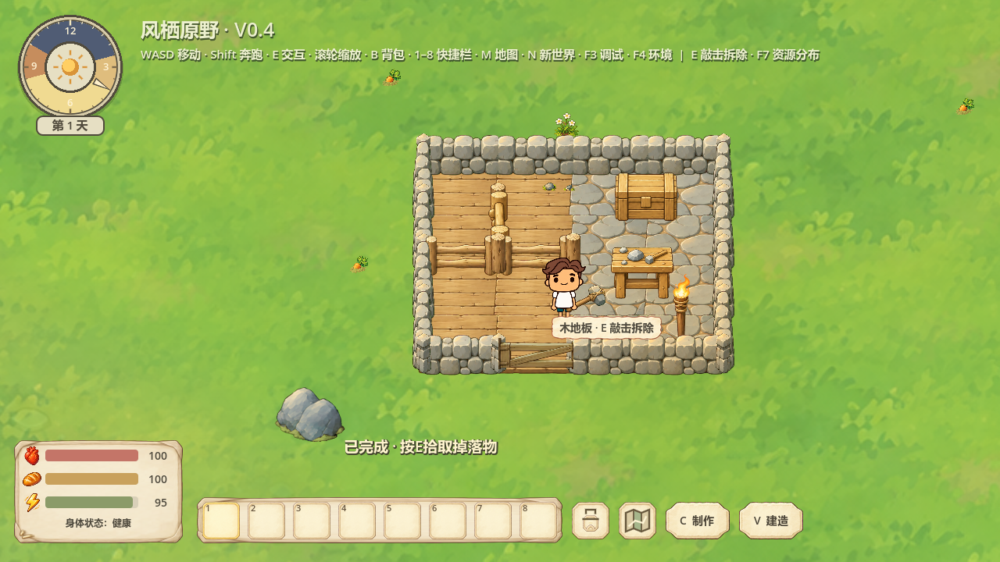
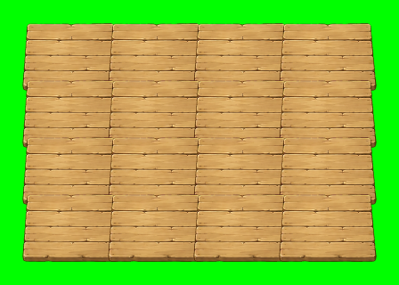
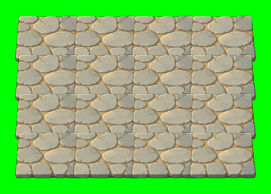

# 营地修正与背视劳动 V5 验证报告

2026-10-18；Godot 4.7.2 Stable，Windows Compatibility / NVIDIA RTX5060。

## 实际修改

- 撤回本轮中途的裁切/镜像平面地板方案。木地板、石路均完整绘制原批准PNG，按原比例统一宽110，仍使用96×64逻辑格，统一边缘重叠连接。无底色填块、无逐块偏移；顶部透视、原画边缘保留，原20张建筑PNG哈希全部一致（art-audit.json）。不改变占用、成本或碰撞。
- 独立残留建筑脚下的异常背景来自受损建筑ProgressBar默认主题最小尺寸。改为无阴影36×3受损条，放在建筑最高处上方；受击立即刷新，门运动同步位置，刷新/重建邻居后不会回到脚下。
- H/T形门真实扫掠允许与直接相连的固定石墙/木栅栏折叠重合。只放行这些相邻静态边段；人物、家具、其他门、非直接相连障碍仍检查，原门板碰撞保持。门扇轻微偏冷深色，方便辨别。
- 用户确认“看书”为“砍树”。采矿、砍树、挖土背视共用石锤已有原生back_mine姿势；按原持握装备替换工具，砍/挖播放时钟对应各自原命中时刻，实际命中和动作时长不变。其他朝向不变，没有新PNG或动作资源。
- 快捷栏已装备实例右键显示“卸下”并调用原卸下，回到原快捷格。过期菜单不会误操作新装备；原满包、实例与耐久保护保留。

## 验证结果

|验证|实际结果|日志|
|---|---|---|
|背视动作、真实交互派发/命中、四工具快捷栏菜单与卸下、满包/陈旧菜单|无头79、真实窗口79，0失败|headless.log / window.log|
|建筑连接、H形开关、受损条、预览与窗口尺寸、存档必要依赖|真实窗口338，0失败|build-window.log|
|整图地板GPU渲染|4项0失败；木/石各75264内部像素露绿0；各30720单块像素对照原Sprite，超容差0|whole-art-floor-tests.json / floor-window.log|
|独立新进程读档|7+3项0失败|restart.log / hinge-restart.log|
|门连续UV纹理（本轮门渲染未再变更）|80组GPU对照0失败|../camp-build-v4/surface-window.log|

测试使用隔离数据，不写用户正式存档。真实窗口由自动控制器驱动，包含原交互入口和原生渲染；不等同长期人工试玩。不同尺寸实景与H形、受损阶段截图留在本目录。地板GPU证明完整原图与内部不露草，不代替用户的主观美术验收。

## 截图

背视见back-contact-mine.png、back-contact-chop.png、back-contact-dig.png及back-real-mine.png/back-real-dig.png；右键见hotbar-unequip-*.png。

## 已撤回与边界

reports/camp-build-v4内早期tiles相关截图/无缝数值属于用户否定的裁切镜像方案，已撤回，不作为最终美术通过证据。最终运行无此逻辑，地板以本目录whole-art系列为准。该阶段H形与受损条修复保留，已由最终338项再次验证。

未测大营地FPS、长时间人工建营；动画中途新进入扫掠区的动态避让仍未实现。本轮不修改采集收益、料理、天气、移动参数、成本与存档版本。完成即停止。
