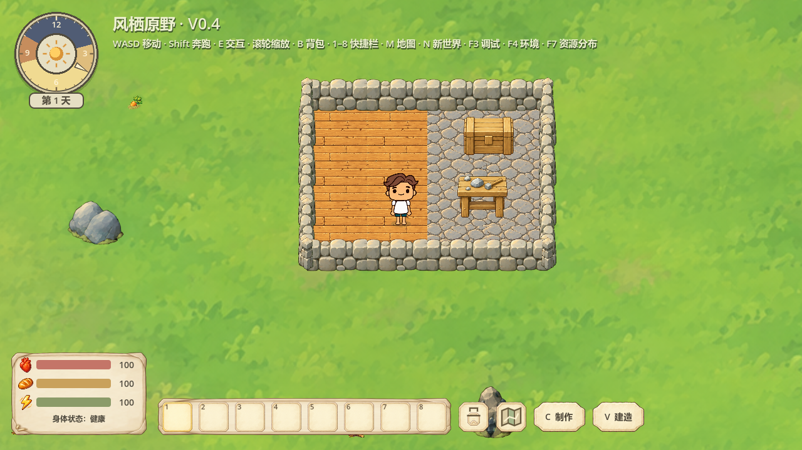
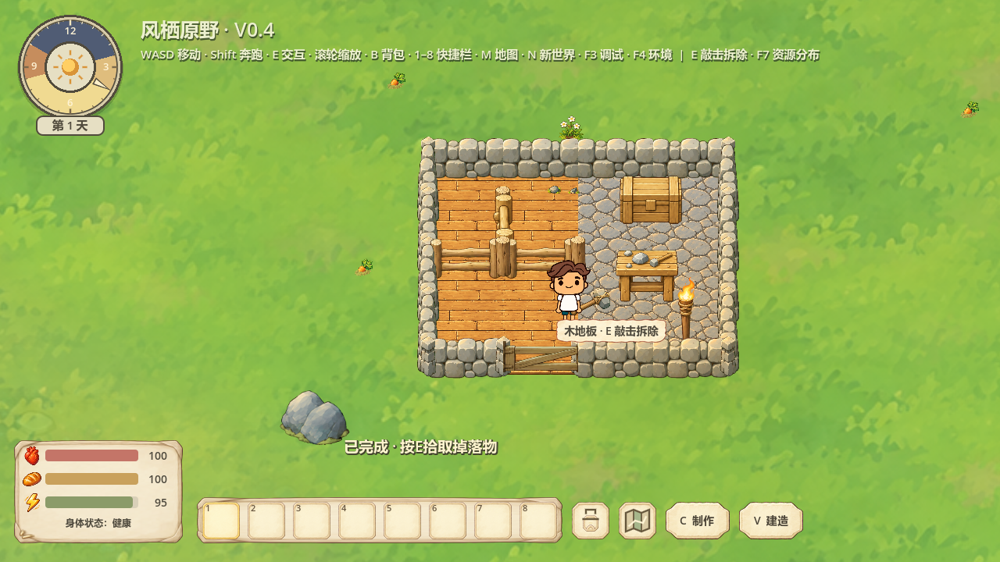

# 方形铺面接缝修订：正式接入

2026-10-18，Godot4.7.2 Stable / Windows / Compatibility / RTX5060。

用户明确“可以的，可以接入游戏了”，本批四张PNG已获具体授权。正式入口Start-Playtest无需预览开关，即显示本版木地板和石路；已有存档内相同建筑ID直接使用新表现，无迁移或重建要求。

## 实际接入

- 将prototypes/camp-floor-seams-v2/final的wood-top、wood-front、stone-top、stone-front四PNG按字节原样迁入assets/buildings/v3。provenance.json登记批准原话、来源、SHA与范围；原v1/v2的20张图保留，未重新生成美术。
- camp_building正式绘制96×64顶面，仅在没有南侧地面邻居时显示原21×96/636薄前沿。木/石混铺同样隐藏内部厚边，保持已确认视角、纹理、颜色及厚度。
- 建造和拆除复用原refresh_around，邻居随实例重建更新外露边；放置预览共用正式绘制，并引用当前正式邻居判断内部厚边。
- 原成本、配方、ID、占用、碰撞、存档版本不变。正式代码不引用候选路径。背视工具图层已在上一轮正式修复，本轮未改动。
- Godot默认fix_alpha_border会调整前沿极少量半透明边像素的采样颜色，故这两张导入设置关闭该选项，保留与获批原始预览完全一致的像素效果；PNG字节保持不变。

## 验证

|范围|结果|日志/证据|
|---|---|---|
|正式铺面渲染、连续木/石/混铺、三档缩放、960/1280/1600窗口、拆除/重建邻居刷新、放置预览、原快照保存再加载|真实窗口20项，0失败|floor-window.log / square-floor-tests.json|
|原建筑、门、墙体、放置/拆除、原保存事务必要依赖|无头338、真实窗口338，0失败|build-headless.log / build-window.log|
|独立新进程原完整营地/门轴状态读档|7+3项，0失败|restart.log / hinge-restart.log|
|正式PNG与获批四图|4/4哈希一致；原20图也不变，全部24/24符合批准哈希|adoption-audit.json / all-approved-art-audit.json|
|正式GPU与获批候选GPU|9组，共2376000像素，最大通道差0、差异像素0|adoption-audit.json|

三档缩放为0.75/1/1.25，包含非整数显示位置，内部拼接扫描露绿0。窗口由自动控制器驱动，测试保存使用reports下隔离路径，不写用户正式存档。旧存档加载后沿原建筑记录重新生成表现，位置、朝向和占用关系保持。

## 范围与遗留边界

本次没有新图片生成；沿用已确认候选的来源与美术质量。候选阶段的safe_frame、完整不透明纹理source_edge_touch警告及非数学零周期纹理边界已记录在reports/back-layer-floor-v6/REPORT.md；用户本次对这批展示效果作了具体确认，不代表未来图自动获批。

未测大营地FPS、长期人工建营或动画中途新障碍动态避让。本轮仅接入已批准铺面，完成停止。
