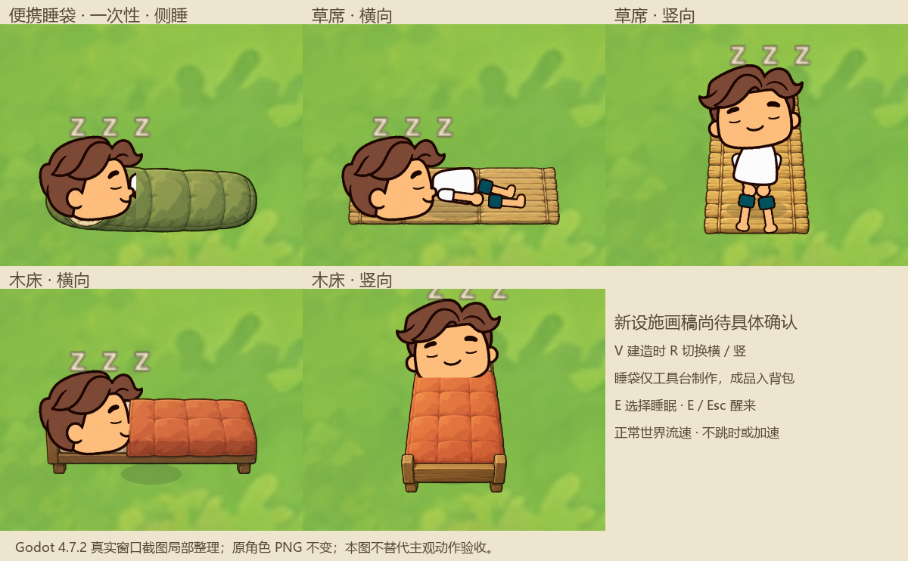

# 睡眠设施与睡眠交互 V1 · 候选验收报告

2026-10-18，Godot 4.7.2 stable，Windows，OpenGL Compatibility / NVIDIA RTX 5060。以下是本轮实际结果，不援引历史测试冒充新验证。

## 当前交付状态

功能、原生睡姿、事务和存档接入已实现；新8张设施PNG仍为 **pending_user**，位于 prototypes/sleep-v1/final。未迁入 assets/sleep/v1，正式新配方保持 default_unlocked=false；正式入口已使用正常流速强制睡眠和制作上下文区分。只有独立睡眠预览临时开放全部新内容。

按用户任务“未经确认的候选素材只能放在候选目录，不能自动推广到正式资源目录”，本轮尚不能标记为全部正式完成。下一步仅需本批具体美术确认，再按哈希原样推广并核对正式路径；不将开发授权或自动化数值检查当作美术批准。

入口：[Start-Sleep-Facilities-Preview.cmd](../../Start-Sleep-Facilities-Preview.cmd)。沿用当前世界身份的Seed，只读身份，不读写玩家物品/环境存档。提供材料、3个睡袋、石锤和附近工具台/横竖床席样例；E睡眠，V预览R横竖，C为徒手，工具台E为工具台制作。装备石锤时沿原E拆除规则，想睡觉需先卸下石锤。

## 已实现

- 便携睡袋仅工具台配方 bench_sleeping_bag，宽叶6/纤维10，原1.5秒制作后入原背包，堆叠5；背包/快捷栏使用进入原放置预览，成功保存才扣1，失败/取消/重复来源快照拒绝不扣。
- 草席（宽叶8/纤维8）、床（木24/纤维12/宽叶8）走原V建造，R切横/竖，方向同时影响画稿、脚底占地、预览、睡姿、被面与存档。保持原其他建筑规则，使用原拆除返50%逐材料向下取整。
- C制作仅徒手配方；工作台包含徒手及专属配方。原五条徒手配方未擅改归属。开始、进行、提交复核原工作台身份/距离/存在，关闭、离开或设施移除取消；提交保存失败回滚完整材料与成品。
- 单一 align/lie/sleep/wake 状态机；所有主动和强制睡眠统一，保留内部中断接口，不新增敌人/攻击系统。身体详情没有睡眠按钮。睡眠全阶段锁定行动，起身后恢复普通移动与交互。
- 睡袋 PLACED/RESERVED/IN_USE/原子移除等价CONSUMED。只在真正睡着并提交IN_USE后恢复，提前取消保留世界睡袋，睡后提前醒也消耗；不会移除附近或背包中无关睡袋。占用中的设施不能拆除。
- 复用原角色PNG、部件支点与 AnimationPlayer，新增独立sleep库：横向侧躺/纵向仰躺各三条动作。分部件坐低/躺下、局部呼吸、起身，不旋转整个人物。原头图局部Shader闭眼，醒来清除。zzz只在sleep阶段显示，随头锚点且限制在屏幕内。睡袋/床以同源真实布面像素做局部前景，头部露出；没有半透明蒙层或重复人物。

## 唯一时间与初始平衡

删除旧睡眠120倍分支；环境日长仍60现实分钟一天，睡眠不改全局倍率、不跳到清晨、不补结算世界时间。每一步原世界、身体、天气、篝火燃料/烹饪与提灯共用实际经过时间；暂停不追赶。

| 来源 | 精力/游戏小时 | 最长游戏小时 | 正常流速实际最长时间 |
|---|---:|---:|---:|
| 睡袋 | 10 | 3 | 7.5现实分钟 |
| 草席 | 13 | 10 | 25现实分钟 |
| 床 | 17 | 10 | 25现实分钟 |
| 强制原地 | 13 | 3 | 7.5现实分钟 |

目标70/95、小睡1小时与最高上限集中在 data/sleep_rules.json。睡袋最满恢复30；床高于草席高于睡袋，原3.2/小时基础精力消耗及身体平衡不改。材料选择使便携一次性睡袋不比营地长期重复床席更划算；未声称已经过长期人工平衡。

最终真实窗口采样：墙钟测量 4.866 秒，原世界累计模拟步长约 5.002639 秒，世界分钟 566.784629 → 568.785684（约2分钟）；床精力 19.975511 → 20.542477，与世界分钟×17/60一致。同期篝火燃料1000 → 994.997361、料理已过 5.002639 秒、提灯1800 → 1794.997361。开始/结束钩子跨帧造成约0.14秒墙钟边界偏差，未将其解释成精确毫秒测量；不存在120倍等量级加速。原始记录 normal-time-trace.json。

## 原子快照与失败边界

body.version=2增加可选sleep_session.version1，原items版本、路径、地图身份不改。保存来源、实例ID/方向、阶段时钟、开始时刻、已睡分钟、目标/上限/速率、锚点与返回位置、结束原因；环境仍用原配对body_environment。真实重新启动恢复当前阶段，不重放已结算时间；未知版本/非法配对保护源文件。

预定及进入IN_USE保存失败会回滚并取消。最终醒来保存失败时不会永久锁住角色：内存保留单向完成状态，dirty=true由原自动保存重试。磁盘仍有此前已经提交IN_USE的检查点，重启按那个已使用状态恢复，不能当作新睡袋或返还物品。未承诺磁盘不可写时能保存最新进度。

旧身体V1/V2缺少会话字段合法；旧已睡记录在原地按正常流速继续/超界安全起身，不离线追赶。正式未知档和玩家档没有用于写入测试。跨进程文件全部位于本报告目录 isolated-*.json。

## 实际运行验证

| 入口 | 实际结果 | 记录 |
|---|---|---|
| 最终综合专项，真实窗口 | 127项，0失败；960×540/1280×720/1600×900 | window-release-candidate.log、window-checks.json |
| 状态/事务/异常专项，无头 | 43项，0失败 | edges-final2.log、edges-checks.json |
| 真实窗口物理与输入 | 10项，0失败；持方向/奔跑锁定、E起身、起身后真实移动及B背包 | controls-window.log、controls-checks.json |
| 独立进程写入 | 25项，0失败；五类方向会话 | persistence-write-second.log |
| 新独立进程读取/恢复/醒来写入 | 70项，0失败 | persistence-read.log |
| 第三独立进程确认消耗/可复用及未知档保护 | 25项，0失败 | persistence-awake.log |
| 原制作进度必要依赖，无头 | 37项，0失败 | crafting-dependency.log |
| 正式入口、独立预览入口 | 两个入口均PASS；新图不在正式入口引用、预览非持久化 | formal-entry.log、preview-entry-final.log |

核心脚本的第一轮无头综合120项0失败属于早期结果；最终以增强后的127项窗口专项为准，不把旧结果计作额外新覆盖。测试由原生控制器、真实窗口渲染和真实输入注入执行，未声称人工长期操作验收。

## 失败记录与修正

保留全部 first/second/final 等原始日志，没有删除失败断言或关闭错误输出。主要修正：初次GDScript类型推断与Skin命名冲突；宽叶ID拼写修正为原broad_leaf；取消预定不再重建未改变的设施，防旧碰撞阻挡立即再次睡眠；承托底层按正常Y排序置于角色后；闭眼Shader改为兼容Godot内置纹理采样；最终保存失败不留下控制锁。测试夹具曾缺少石材导致找不到工作台、前一会话未清理、把最终结束原因读早一阶段，以及内陆出生范围没有水；均修正真实夹具并重新运行，水域改用真实已加载海岸，未模拟成水。

## 美术来源和质量记录

generate2dsprite → route_media → Codex(local CLI)/image_gen；原图/实际参考/提示词/回执位于 art/sleep-v1。底层图像模型精确版本和实际费用未知，记账估价0不等于已确认免费。原角色与已批准建筑PNG没有修改。

新图8张：睡袋/草席/床横向底图3、床席纵向底图2、睡袋与两方向床前景3。prototypes/sleep-v1/provenance.json登记全部SHA与整理坐标，仍pending_user。PNG实际导入成功；png-qc.json记录尺寸/alpha包围盒/透明边，8张均与候选provenance哈希一致，画布边界至少16像素透明留白。

原横向图实际1536×1024而非请求1024×1536，三物件不位于均匀三行中；按所有权0–350/350–620/620–1024重新分配并留白，不丢物件像素。纵向原图也出现源格边缘警告，最终加64像素所有权留白后重新处理，当前 vertical-processed-v2 和横向 processed 的处理QA均pass。以下原始FAIL/WARN照录，不能称原始美术QA无警告；环境doctor另有python.path、deps.scipy、paths.cwd三个WARN及可选工具缺失，详见doctor.json。

| 记录文件（art/sleep-v1下） | id | status | value | threshold |
|---|---|---|---|---|
| spill/sheet-qc.json | cross_cell_components | fail | `1` | `0` |
| spill/sheet-qc.json | cross_cell_visible | fail | `1` | `0` |
| spill/sheet-qc.json | boundary_band | warn | `556` | `0` |
| spill/sheet-qc.json | safe_frame | warn | `2` | `0` |
| vertical-spill/sheet-qc.json | boundary_band | warn | `896` | `0` |
| vertical-spill/sheet-qc.json | safe_frame | warn | `1` | `0` |
| vertical-processed/pipeline-meta.json | source_edge_touch_frames | warn | `[[1, 0]]` | `[]` |

以上数值不证明睡姿自然、透视或画稿主观满意。纵向新图由图像模型独立绘制，不旋转横图；床架的手绘透视和人物承托仍请用户在候选实景中确认。

## 文件与未验证范围

文件职责：新增sleep_*脚本和规则负责唯一会话/原生动作/UI；BodyState和environment_view负责实际数值/唯一时间；原item/craft/build/world/player脚本仅增加接入、上下文校验与必要事务保护。数据新增三ID、一条工具台配方和两条建造配方；现有五份规范及SLEEP_SYSTEM.md、DEVLOG.md已更新。详细本轮文件及SHA见 files.json；生成/包装脚本不作为游戏运行依赖。

未做全量回归、长期人工从零采集/制作/睡眠平衡、大营地FPS、联机、睡眠中攻击系统或复杂房屋/医疗系统。未将候选静态截图当作美术批准。完成本轮实现与候选验收准备后停止，等待本批具体确认，不进入其他玩法。
